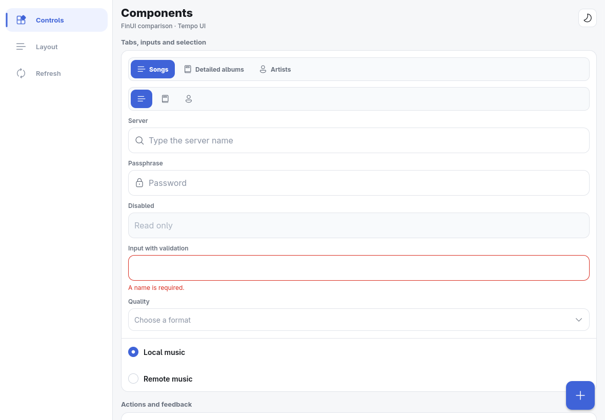

# Tempo UI

Tempo UI is a Slint component library derived from FinUI. It includes themed controls, responsive navigation, dialogs and sheets, refreshable and reorderable lists, motion helpers, and a set of Fluent icons. The Slint components share a single import. The optional Rust helpers cover route history and CJK font fallback.



## Run the showcase

Use Rust 1.95 or later and a desktop graphical session.

```sh
cargo run --release --locked -p tempo-ui-showcase
```

| Arguments after `--` | Showcase |
| --- | --- |
| `--compact --dark` | Narrow dark layout |
| `--layout --wide` | Three-pane layout |
| `--lists` | Virtualized list, queue reordering, and action menu |
| `--music` | FMusic-inspired sample browser with simulated playback |

The showcase prefers FemtoVG and includes a software renderer. Set `SLINT_BACKEND=winit-software` to select software rendering. See the [narrow layout](docs/images/catalog-compact.png) and [list controls](docs/images/flutter-replacements-compact.png).

## Use the components

Add Tempo UI to your application checkout, for example under `vendor/TempoUI`. Use Slint and `slint-build` 1.19.1 to match the tested version. Register the library entry from your application's `build.rs`.

```rust
use std::{collections::HashMap, env, path::PathBuf};

fn main() {
    let project = PathBuf::from(env::var_os("CARGO_MANIFEST_DIR").unwrap());
    let libraries = HashMap::from([(
        "tempo-ui".into(),
        project.join("vendor/TempoUI/ui/index.slint"),
    )]);
    let config = slint_build::CompilerConfiguration::new().with_library_paths(libraries);
    slint_build::compile_with_config("ui/main.slint", config).unwrap();
}
```

```slint
import { TempoButton, TempoTheme } from "@tempo-ui";

export component App inherits Window {
    background: TempoTheme.background;

    VerticalLayout {
        padding: 16px;
        TempoButton { label: "Continue"; }
    }
}
```

The [showcase build script](examples/showcase/build.rs) uses this same import mechanism. For Rust route history, add `tempo-ui = { path = "vendor/TempoUI" }` under `[dependencies]`. Enable the `finui-font-fallback` feature to use `tempo_ui::fonts::configure_finui_fallbacks()` before constructing a window.

## Verification

```sh
cargo test --workspace --locked
./scripts/check.sh
```

The smoke checks require a graphical session and cover wide and narrow layouts, keyboard and pointer input, overlays, refresh, list virtualization, and animations. GitHub Actions runs the software-renderer checks on Linux. See the [FinUI component mapping](docs/PORTING.md) and [Flutter-to-Slint implementation notes](docs/REPLACEMENTS.md) for the scope of platform-specific behavior.

## License

Tempo UI uses the [MIT license](LICENSE). Attribution for the FinUI adaptation and Microsoft Fluent System Icons is in [LICENSES](LICENSES/).
